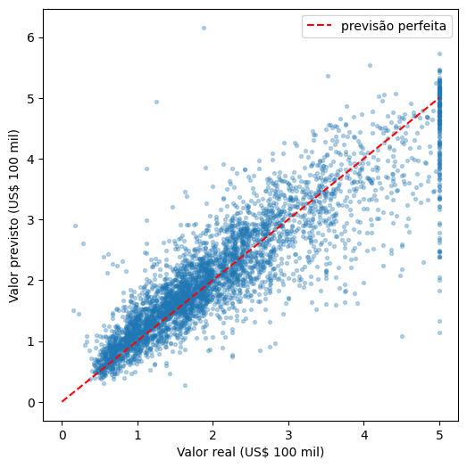
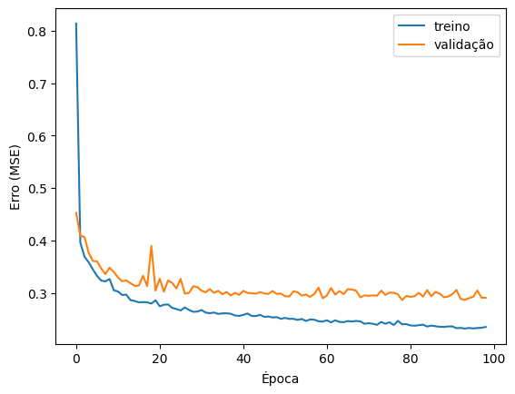

# Previsão de preços de imóveis com rede neural

Projeto de estudo em que uma rede neural (Keras/TensorFlow) prevê o valor mediano das casas de uma região da Califórnia, comparando com uma regressão linear como baseline.

## Dados

Dataset *California Housing* (scikit-learn), baseado no censo americano de 1990. Cada linha é uma região (*block group*), com 8 variáveis: renda mediana, idade mediana das casas, média de cômodos, média de quartos, população, ocupação média, latitude e longitude. O alvo é o valor mediano das casas da região, em unidades de US$ 100 mil.

## Metodologia

1. Divisão 80/20 em treino e teste (`random_state=42`)
2. Normalização com `StandardScaler`, ajustado apenas no treino para evitar *data leakage*
3. Baseline: regressão linear
4. Rede neural: Dense(64, ReLU) → Dense(32, ReLU) → Dense(1), com otimizador Adam e loss MSE
5. `EarlyStopping` (patience=20) monitorando a loss de validação

## Resultados (conjunto de teste)

| Modelo | MAE | RMSE | R² |
|---|---|---|---|
| Regressão linear | 0,533 | 0,746 | 0,576 |
| Rede neural | 0,349 | 0,521 | 0,793 |

A rede neural erra em média cerca de US$ 35 mil, contra US$ 53 mil da regressão linear.

## Observações

- Com 500 épocas, a validação parou de melhorar por volta da época 100 enquanto o erro de treino continuava caindo (overfitting leve).
- Com `EarlyStopping`, o treino parou na época 97 e o MAE foi praticamente o mesmo (0,355 → 0,349, diferença dentro da variação normal entre execuções). O ganho foi treinar em uma fração do tempo.
- O modelo erra mais nas regiões mais caras, e tende a superestimar as baratas e subestimar as caras.

## Limitações

- Os preços do dataset são limitados a US$ 500 mil, então a rede nunca vê o valor real das regiões mais caras.
- Os dados são de 1990 e não refletem o mercado atual.
- O alvo é por região, não por imóvel individual.
- A saída da rede não é restrita e pode gerar valores sem sentido (ex.: negativos).
- Usei uma única divisão treino/teste e uma única execução, sem medir a variação entre sementes.

## Próximos passos

- Testar outras arquiteturas e ajustar hiperparâmetros
- Validação cruzada
- Comparar com Random Forest e Gradient Boosting, que costumam ir muito bem em dados tabulares
